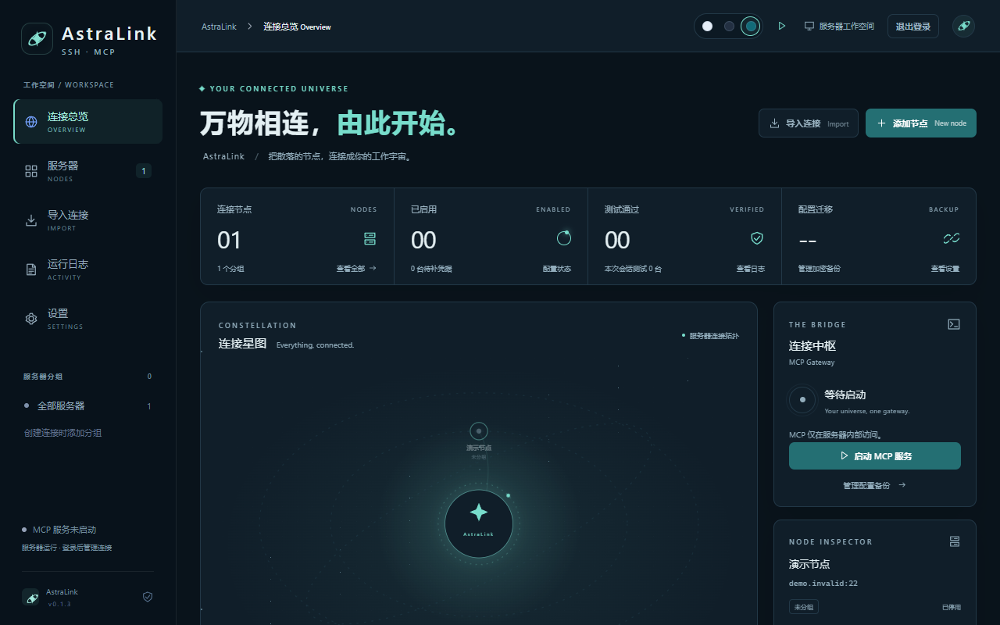

# AstraLink

AstraLink 提供 SSH 连接管理和内置 MCP 服务，可安装桌面客户端，也可通过 Docker 部署网页版。下方镜像支持 `linux/amd64`。



## 桌面客户端下载

在 [GitHub Releases](https://github.com/xinglinglove1029/astralink/releases) 选择**已发布**的版本，按系统下载安装包：

| 平台 | 安装包 |
| --- | --- |
| Windows x64 | `AstraLink_*_x64-setup.exe` |
| macOS Apple Silicon | `AstraLink_*_aarch64.dmg` |
| macOS Intel | `AstraLink_*_x64.dmg` |
| Linux x64 | `AstraLink_*_amd64.deb` 或 `AstraLink_*_amd64.AppImage` |

桌面版可在“设置 → MCP 接入”查看各客户端配置片段，并按需复制访问令牌。支持 Claude Code、Codex、Cursor、VS Code、旧版 Windsurf Cascade、Antigravity、OpenCode、OpenClaw、Hermes、Claude Desktop、WorkBuddy 和 Cherry Studio；不同客户端的接入方式以应用内指引为准。云端 ChatGPT 不能直接连接本机回环地址，需要另行配置受保护的网关或隧道。

可导入 Xshell、Tabby、Netcatty、FinalShell、NyaTerm、MobaXterm、SecureCRT、Electerm、WindTerm、Termius、OpenSSH 及 MCP JSON 中的 SSH 连接；加密或无法读取的凭据需导入后重新填写。桌面端和服务器端配置彼此独立，可通过加密备份迁移。

## Docker Compose 部署

在服务器上创建 `docker-compose.yml`，内容如下。首次部署前，将 `ASTRALINK_ADMIN_PASSWORD` 改成自己的密码（至少 12 个字符），不要提交含真实密码的文件。

```yaml
name: astralink
services:
  astralink:
    image: xinglinglove1029/astralink:v0.1.10
    restart: unless-stopped
    ports:
      - "1421:1421"
    environment:
      ASTRALINK_ADMIN_PASSWORD: ""
    volumes:
      - astralink-data:/var/lib/astralink
volumes:
  astralink-data:
```

从 `v0.1.10` 起，正式发布同时更新 `latest`。需要跟随正式版本时，可将上面的镜像标签改为 `latest`；预发布版本不更新它。

在 `docker-compose.yml` 所在目录执行：

```bash
docker compose pull
docker compose up -d
docker compose ps
```

## Docker 部署

不使用 Compose 时，先拉取 Docker Hub 镜像，并创建持久卷：

```bash
docker pull xinglinglove1029/astralink:v0.1.10
docker volume create astralink-data
read -rsp '设置管理员密码（至少 12 个字符）: ' ASTRALINK_ADMIN_PASSWORD; printf '\n'
export ASTRALINK_ADMIN_PASSWORD
docker run -d --name astralink --restart unless-stopped \
  -p 1421:1421 \
  -v astralink-data:/var/lib/astralink \
  -e ASTRALINK_ADMIN_PASSWORD \
  xinglinglove1029/astralink:v0.1.10
unset ASTRALINK_ADMIN_PASSWORD
docker ps --filter name=astralink
```

部署后用浏览器打开 `http://服务器IP:1421/`，初始用户名为 `admin`，密码是首次启动时设置的 `ASTRALINK_ADMIN_PASSWORD`。密码仅在全新数据卷首次启动时生效；重启或升级不会重置已有密码。Docker Compose 和单容器示例默认创建**不同**的命名卷，不要在两种部署方式间直接切换数据卷。

从 `v0.1.8` 起，Web 支持多用户。管理员可在左侧“用户管理”菜单创建、停用和删除账号（新账号默认查看者），并为启用的管理员或操作员签发个人 MCP 令牌；在“角色管理”菜单通过穿梭框绑定三个内置角色的成员。查看者不能领取令牌，需先调整角色；目前不支持自定义角色权限。连接配置仍是共享的。管理员管理用户、设置、备份和统计，操作员维护连接并调用 MCP，查看者只读。用户可在“设置 → 安全与更新”修改自己的密码；密码或角色改变会使旧会话及个人 MCP 令牌失效。Web MCP 客户端需要用户各自生成个人令牌，升级后旧共享令牌不再接受。令牌只在生成时提供一次，请安全保管并为客户端更新配置。

管理员在左侧“调用审计”菜单查看网页与 MCP 调用记录；“统计大屏”展示最近 7 天按用户、操作、渠道、连接和时间的汇总。审计只保存元数据，不保存命令、参数或输出。网页审计保留 90 天，MCP 审计保留最近约 16 MiB；超过保留范围的数据不计入统计。服务器数据卷包含用户库与审计文件，需一并保护和备份。

管理页通过 HTTP 访问时，密码和会话以明文传输；不可信网络请使用 HTTPS 反向代理。MCP 默认只监听容器内的 `127.0.0.1`，映射管理端口不会将 MCP 对外开放；WorkBuddy / Cherry Studio 的服务器接入及远程监听设置见部署说明。更多运维说明见 [服务器部署说明](docs/server-deployment.md)。
