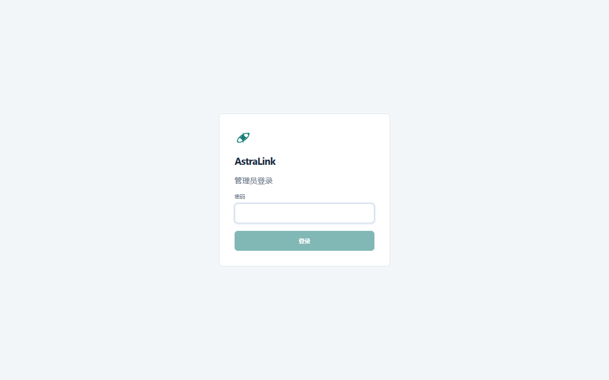
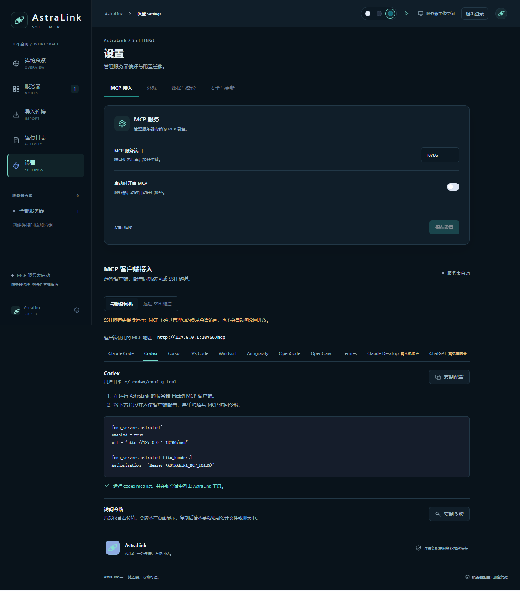

# AstraLink

AstraLink 集中管理 SSH 连接和内置 MCP 服务。可安装 Windows/macOS/Linux 桌面客户端，也可将管理服务部署在 Linux 服务器上，通过浏览器配置；两种运行方式互不影响。桌面与服务器的数据相互独立，可通过设置页的加密备份迁移连接和应用设置。

技术栈：Tauri 2、Vue 3、TypeScript、Rust、Node SSH MCP 引擎。服务器镜像当前提供 **linux/amd64**。


## Docker Compose 部署（推荐）

以下命令在 Linux shell 中执行；Windows 可在 WSL 的 Docker 环境中执行。需安装 Docker Engine 和 Compose 插件。Compose 默认将管理端口绑定到所有 IPv4 网卡；把示例地址替换成服务器实际 IP，其他电脑即可访问登录页。

```bash
git clone https://github.com/xinglinglove1029/astralink.git
cd astralink

export ASTRALINK_IMAGE=xinglinglove1029/astralink:v0.1.4
export ASTRALINK_PUBLIC_ORIGIN=http://192.168.97.240:1421 # 换成你的服务器 IP
docker compose -f compose.server.yml pull astralink

# 只在第一次部署时执行；没有默认账号或密码，密码至少 12 个字符。
read -rsp '设置管理员密码: ' ADMIN_PASSWORD; printf '\n'
printf '%s\n' "$ADMIN_PASSWORD" | docker compose -f compose.server.yml run --rm -T --no-deps astralink init-admin
unset ADMIN_PASSWORD

docker compose -f compose.server.yml up -d --no-build
docker compose -f compose.server.yml ps
curl -fsS http://192.168.97.240:1421/api/auth/status
```

浏览器打开 `http://192.168.97.240:1421/`（替换成你的服务器 IP），只输入初始化时设置的管理员密码，不需要用户名。`/api/auth/status` 返回 `{"authenticated":false}` 表示服务可访问但尚未登录，**不是部署失败**。如要使用 HTTPS 反向代理，需将 `ASTRALINK_PUBLIC_ORIGIN` 改为浏览器实际使用的 `https://域名`；示例见[服务器部署说明](docs/server-deployment.md)。

镜像 `v0.1.4` 的管理端口默认可被所有网卡访问，**但仍需要管理员登录**，且登录的 Origin 必须与 `ASTRALINK_PUBLIC_ORIGIN` 一致。HTTP 会明文传输密码和会话；在不可信网络使用时应改用 HTTPS。旧版 `v0.1.3` 镜像不支持非回环 HTTP；详见[部署说明](docs/server-deployment.md)。

以上命令从仓库当前 `main` 获取 Compose 文件，并将实际运行的镜像固定为 `v0.1.4`。

> **MCP 网络边界：** 管理页面的 HTTPS 地址不是 MCP 地址。MCP 引擎仅监听容器内部的 `127.0.0.1`，网页登录 Cookie 也不是 MCP 令牌；只映射容器端口不会将该回环服务安全地开放给远程客户端。服务器远程 MCP 接入需另外设计受保护的网关，不能把管理页地址填进 Codex。

### 升级与数据

连接、管理员密码哈希、加密凭据和主密钥保存在 Compose 的 `astralink-data` 命名卷。升级镜像时继续使用同一 Compose 项目和卷，**不要重跑 `init-admin`**：

```bash
export ASTRALINK_IMAGE=xinglinglove1029/astralink:v0.1.4 # 改成要升级到的版本
docker compose -f compose.server.yml pull astralink
docker compose -f compose.server.yml up -d --no-build
```

除了加密配置备份，还应单独备份服务器数据卷；配置文件备份不包含登录密码、MCP 令牌或私钥文件。更换镜像后已有网页登录会话会失效，需要重新登录。其他端口、Docker 单容器命令、本地构建及 HTTPS 部署参见[服务器部署说明](docs/server-deployment.md)。

## Docker 单容器部署

不使用 Compose 时可用以下命令，命名卷与上面的 Compose 卷**不是同一个卷**；两种部署方式不要同时指向同一份数据：

```bash
docker volume create astralink-data
docker pull xinglinglove1029/astralink:v0.1.4
read -rsp '设置管理员密码: ' ADMIN_PASSWORD; printf '\n'
printf '%s\n' "$ADMIN_PASSWORD" | docker run --rm -i \
  -v astralink-data:/var/lib/astralink \
  xinglinglove1029/astralink:v0.1.4 init-admin
unset ADMIN_PASSWORD
docker run -d --name astralink --restart unless-stopped \
  -p 0.0.0.0:1421:1421 -v astralink-data:/var/lib/astralink \
  -e ASTRALINK_PUBLIC_ORIGIN=http://192.168.97.240:1421 \
  xinglinglove1029/astralink:v0.1.4
docker logs --tail 50 astralink
```



## 浏览器配置

登录后可增删连接、导入 SSH 客户端配置、启停服务、查看日志，并在“设置 → 数据与备份”导出或导入带口令的 AstraLink 加密备份。口令由导出者设置，导入时使用同一个口令；系统不保存口令。网页版和桌面版均提供相同的设置分类，桌面版另外支持写入本机 AI 客户端配置。网页版选择文件时上传的是浏览器选取的文件，不会读取访问者电脑的绝对路径。



截图来自独立演示容器，仅含 `demo.invalid` 示例连接；未使用真实服务器、密码或 MCP 访问令牌。

## 开发

Windows 需要 Rust stable（MSVC）、Visual Studio C++ Build Tools 和 Windows SDK。运行时依赖 WebView2。已提供 Tauri 启动脚本，能在安装 Rust 后自动将当前用户的 `.cargo/bin` 加到子进程 PATH。

```powershell
npm install
npm run desktop
```

仅开发前端界面：`npm run dev`。此 Vite 地址不是上面的服务器管理服务，不能调用 Tauri 或服务器管理 API；要测试完整浏览器流程，请启动 `astralink-server` 或 Docker 镜像。

## 独立验证入口

```powershell
npm test
npm test --workspace @astralink/engine
cargo test --manifest-path src-tauri/Cargo.toml
npm run build
```

普通 build 只执行类型检查和打包，不自动跑测试。

## 构建桌面安装包

```powershell
npm run desktop:build
```

Windows 产物位于 `src-tauri/target/release/AstraLink.exe` 和 `src-tauri/target/release/bundle/nsis/AstraLink_*_x64-setup.exe`。macOS 使用 `AstraLink.app` / `AstraLink_*.dmg`，Linux 使用 `AstraLink_*.deb` / `AstraLink_*.AppImage`（系统包 ID 按平台规则为小写 astralink）。

资源准备脚本将 Node 运行时、锁定依赖和引擎代码放入被 Git 忽略的资源目录。环境变量 `ASTRALINK_NODE_BINARY` 可指定经过验证的 Node 可执行文件。用户运行完整包不需要手动 npm 安装。

同一命令可在原生 macOS 和 Linux 环境构建：macOS 生成 DMG，Linux 生成 DEB/AppImage。GitHub 的 **Build desktop packages and server image** 工作流提供 Windows x64、macOS Intel/Apple Silicon、Linux x64 四个桌面构建任务，`v*` 标签成功构建后发布 GitHub Release；配置 Docker Hub 仓库 Secrets 后还会发布 `xinglinglove1029/astralink:v版本` 镜像。详情及验证边界见 [跨平台构建说明](docs/cross-platform-build.md)。

Node 路径按平台识别：显式覆盖路径、内置运行时、系统 PATH。未找到时界面提示安装 Node.js；Windows 使用 `node.exe`，macOS/Linux 使用 `node`。

桌面和引擎的状态、实际导入兼容范围和验证证据以 docs/validation.md 为准。架构和接口见 docs/api-contract.md 与 docs/superpowers/specs/2026-10-14-astralink-design.md。

## 数据和凭据

导入页支持 Xshell、MobaXterm `.mxtsessions`、WindTerm `user.sessions`、SecureCRT XML、FinalShell `conn`、Termius 本机 IndexedDB、Electerm 书签 JSON、NyaTerm 本机 `.redb` / v1 JSON、OpenSSH config，以及 NyaTerm `.nya` 加密备份。所有来源先预览再确认，仅导入 SSH 连接；不兼容的协议和不能安全转换的认证配置会在预览里标明。FinalShell 加密密码需补齐；NyaTerm `.redb` 只读连接和分组元数据，不读取其凭据表；Termius 使用本机系统凭据库中的 localKey 解密 IndexedDB 副本；WindTerm 主密码仅在本次预览使用。`.nya` 需备份密码和完整性校验，只提取 SSH 会话，不恢复 NyaTerm 的全量应用状态。内联私钥不会被写入本机文件，需重新选择私钥路径。

设置页支持手动导出/导入本地加密备份，桌面版还支持 HTTPS WebDAV 手动备份。新版快照包含连接元数据、密码、私钥口令、动态密钥和可迁移的应用设置；**不包含**私钥文件、管理员登录信息或 MCP 访问令牌。Argon2 派生密钥、XChaCha20-Poly1305 加密；覆盖和恢复需先预览并确认。WebDAV 地址和账号仅在本机保存，WebDAV 密码与备份口令不保存；WebDAV 尚未在真实服务上验收。

桌面个人连接数据保存在操作系统应用数据目录；服务器连接数据保存在持久卷。两者都不提交到仓库。凭据与 MCP 访问令牌由 Rust 管理，产品日志不打印认证材料；MCP 和控制入口使用不同令牌，并只监听各自运行环境中的回环地址。

项目目录为 `F:/develop/astralink`，项目、程序与安装包名称统一为 AstraLink（npm 包名 astralink，引擎 @astralink/engine）。应用标识和系统凭据库使用 `dev.astralink.desktop`，数据库使用 `astralink.db`，MCP 配置键使用 `astralink`。首次启动会从旧版目录复制数据库和恢复日志，旧文件保留；凭据按需迁入新的系统凭据库。重新点击客户端的一键接入后，会备份并迁移旧版本机 MCP 条目，然后重新加载客户端。

设置页的“MCP 客户端接入”提供 Claude Code、Claude Desktop、Codex、Cursor、VS Code、旧版 Windsurf Cascade、Antigravity、OpenCode、OpenClaw、Hermes、WorkBuddy 和 Cherry Studio 的接入指引。Claude Desktop 与 WorkBuddy 使用随安装包提供的 stdio 桥接，可写入各自的本机用户配置；Cherry Studio 可在其 MCP 管理界面导入 stdio 桥接片段，桌面版会自动填入本机 Node 和脚本绝对路径。片段只显示令牌占位符，令牌须在桌面界面显式点击复制。云端 ChatGPT 不能直连本机回环地址，需在有权限的工作空间配置 Secure MCP Tunnel，或单独部署经认证的公网 HTTPS 网关，当前不提供本机一键接入。修改端口后先保存并重启 MCP 服务，再更新客户端配置。

## 上游

SSH 工具能力基于 classfang/ssh-mcp-server（ISC），保留其许可证。AstraLink 对其传输、凭据、OTP 和连接配置生命周期做集成适配。前端为 Vue。
